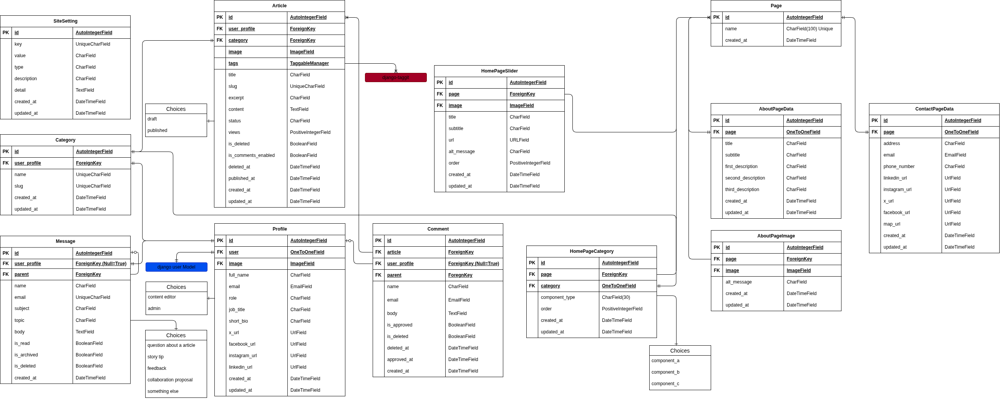

  

   

  
  
  
  
  

 

<h1 align="center">Django Simple Blog</h1>
<h3 align="center">A simple and lightweight blog built with Django, designed for easy post management and publishing.</h3>

---

# Guideline
- [Guideline](#guideline)
- [Demo](#demo)
  - [Homepage](#homepage)
- [Database Schema](#database-schema)

---

 

# Demo

## Homepage

---

 

# Database Schema

---
